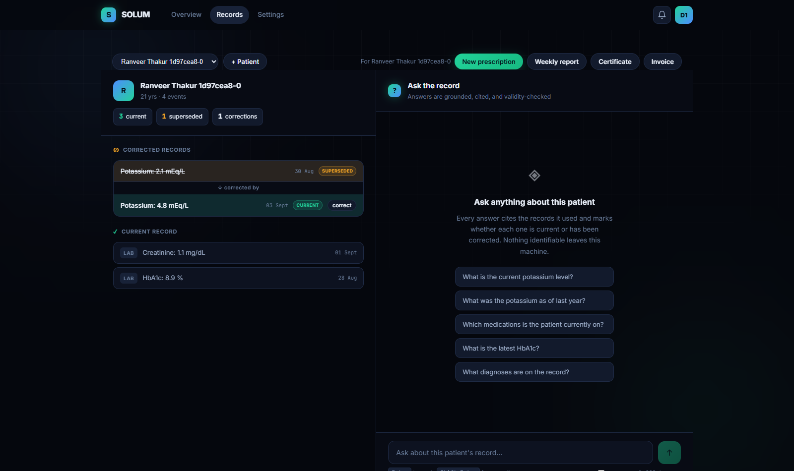
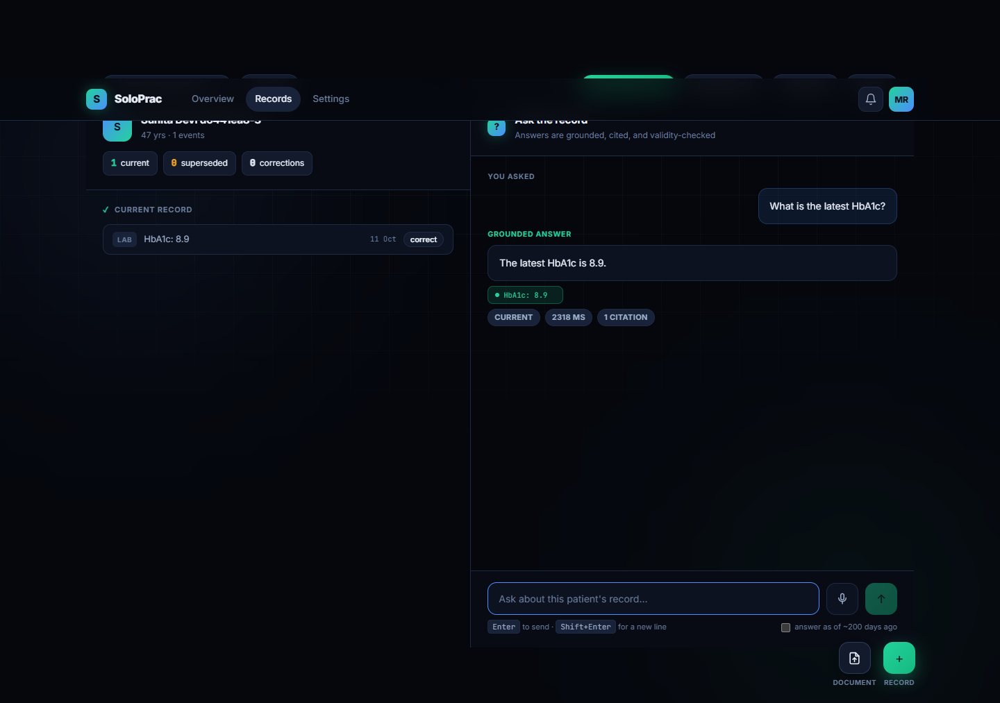
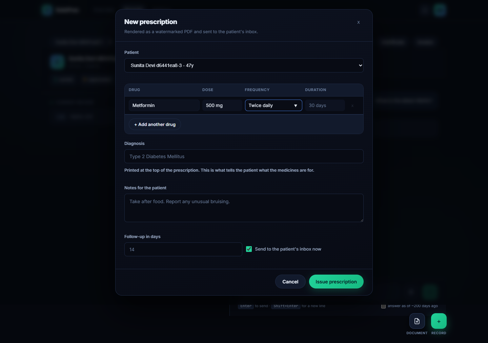
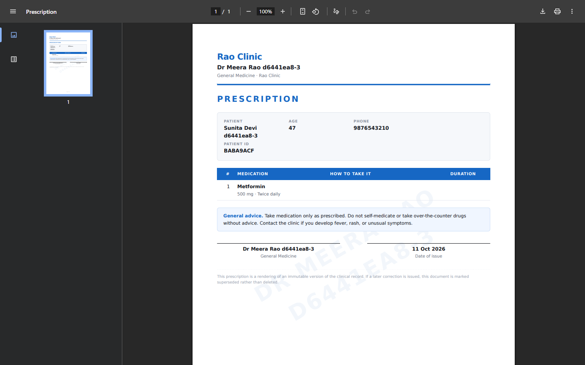
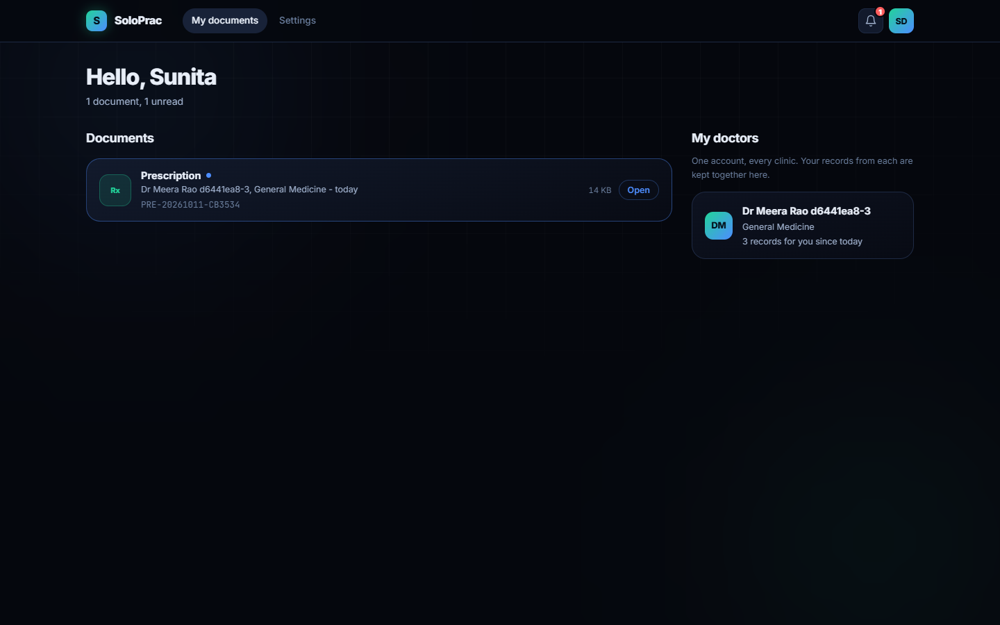
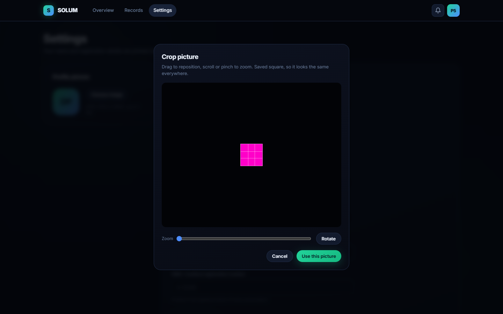
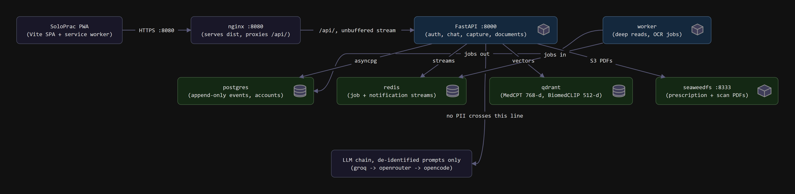
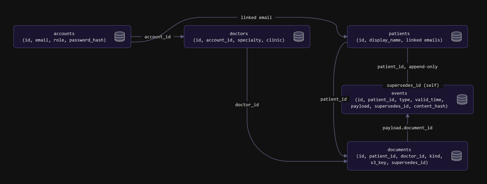
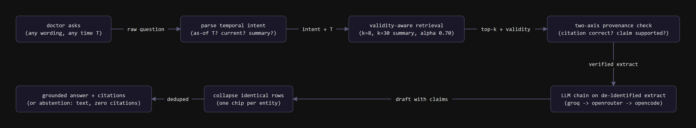
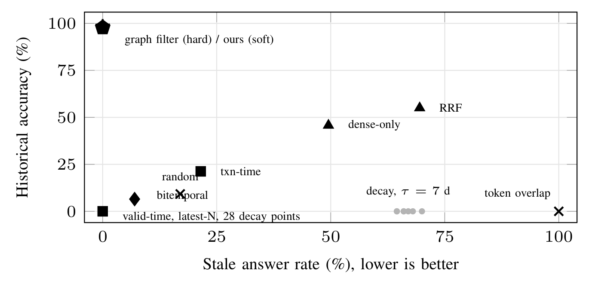

# SoloPrac

### Clinical records that know what changed.

A validity-aware, multimodal record assistant for solo GPs and small clinics.
Built to run on one laptop, keep patient data local, and answer from the chart
with citations instead of guesses.

[Watch the demo](#demo) · [What it does](#what-it-does) · [Architecture](#architecture) · [Quick start](#quick-start) · [Evaluation](#evaluation) · [Team](#team)



---

## Why this exists

Most Indian doctors who run a clinic alone have no IT staff, keep half their
history on paper, and see a new patient every few minutes. They need a record
system that is fast, affordable, and honest about what changed.

There is a quiet failure hiding in ordinary clinical software. A doctor corrects
an HbA1c from 8.9% to 6.8%. The old value cannot simply be deleted — someone may
already have acted on it — so it stays in the chart beside the correction. A
standard retrieval-augmented assistant then sees two nearly identical records and
can happily answer with the withdrawn value, with a citation to prove it.

We call this the **supersession problem**. SoloPrac stores every correction as a
new append-only event that points at the event it replaces. Validity is derived
at read time, never stored as a status flag. Ask about today and the answer uses
the current value. Ask about last spring and the answer reconstructs what the
chart said back then.

---

## Demo

https://github.com/user-attachments/assets/dc154cb6-94a5-4b00-9b4b-e29e6b20874a

**3 min 54 s · silent · 1080p WebM.** The player above is the full walkthrough.
The original file is also kept in
[`docs/videos/SoloPrac-demo.webm`](docs/videos/SoloPrac-demo.webm).

The recording follows one doctor and one patient from an empty dashboard to a
full record: patient creation, five record kinds, chest X-ray and brain MRI
indexing, cited chat, an abstention when the record does not answer the question,
a correction with as-of history, all four generated PDFs, the patient portal, and
photo capture.

---

## What it does

| For the doctor | What SoloPrac gives you |
|---|---|
| **Current vs. withdrawn values** | Every correction is shown as a superseded/current pair, not silently overwritten. |
| **“What did we know then?”** | Ask as of any date and get the value that was in force at that moment. |
| **Answers you can check** | Chat replies cite the exact records used and mark whether each one is current or corrected. |
| **Multimodal records** | Lab reports, scans, prescriptions, vitals, diagnoses, and notes live in one timeline. Text and images get separate embeddings that share a search space. |
| **Paper capture with a gate** | Photograph a report and let OCR read it. If confidence falls below the threshold, nothing is written; the upload is held for human review. |
| **Documents that leave the clinic** | Prescription, certificate, invoice, and weekly report generate as watermarked PDFs and land in the patient’s inbox. |
| **One patient, many clinics** | A doctor can register a patient by email; when the patient signs up later, the records link to one identity with an audit trail. |
| **No lock-in** | Postgres, Redis, Qdrant, and SeaweedFS run locally in Docker. The model chain can use free tiers, and the app degrades honestly when a provider is unavailable. |

### The product in pictures

| Doctor console | Grounded, cited answers |
|---|---|
|  |  |

| Prescription composer | Generated PDF |
|---|---|
|  |  |

| Patient portal | Photo capture and crop |
|---|---|
|  |  |

---

## Architecture



The browser is a React/Vite PWA served by nginx. nginx proxies `/api` to a
single FastAPI process. Postgres holds the append-only event history, Redis
carries jobs and notification streams, Qdrant stores the text and image vectors,
and SeaweedFS stores generated PDFs and uploaded scans. A separate worker handles
deep reads and OCR, so a slow scan does not hold up the chat.

The privacy line is deliberate: local models and the retrieval stack run on the
machine, and only de-identified prompts may cross to an external LLM. The
de-identification gate is enforced by default and is not something to switch off
in a clinic that holds real patient data.

### Data model



The chart is append-only. The `events` table has no mutable status column: a
correction is another event whose `supersedes_id` points at the event it
replaces, and the current/historical state is worked out on read. `documents`
keeps the S3 key and the same supersession link, so even a re-issued PDF has a
lineage instead of overwriting its predecessor.

### From question to cited answer



1. The question is parsed for temporal intent: current, as-of a date, or a
   summary.
2. Validity-aware retrieval filters the candidate events for that instant, then
   combines dense similarity with lexical evidence.
3. A two-axis provenance check asks whether the citation is correct and whether
   the claim is actually supported by it.
4. Only the de-identified extract reaches the LLM chain. If no model is
   available, the same path returns cited extracts instead of inventing prose.
5. Identical rows are collapsed to one chip per entity, and the answer either
   ships with citations or abstains with zero citations.

More detail:

- [System design](docs/SystemDesign.md)
- [Literature survey](docs/LiteratureSurvey.md)
- [Feasibility study](docs/FeasibilityStudy.MD)
- [Editable diagram sources](docs/diagrams/)

---

## Quick start

### Prerequisites

- Docker Desktop with Compose
- Python 3.12+ if you want to run the backend or tests outside Docker
- Node.js 20+ if you want to work on the frontend
- Optional: model weights for MedCPT, BGE-M3, BiomedCLIP, and MedGemma
  (see `.env.example`). Without them the API still starts, but retrieval falls
  back to lexical similarity and vision stays off.

### Run the stack

```bash
git clone https://github.com/RohanBhoge15/SolumCapstone.git
cd SolumCapstone

cp .env.example .env        # Windows: copy .env.example .env
# Open .env and add at least one LLM key, or leave the chain empty.
# The app will still run in cited-extract mode without a model.

docker compose up -d --build
```

Open:

- **App:** http://localhost:8080
- **API docs:** http://localhost:8000/docs
- **Qdrant dashboard:** http://localhost:6333/dashboard

Seed a demonstration patient with a real correction history:

```bash
docker compose exec api python scripts/seed_demo.py
```

Stop the stack with `docker compose down`. Add `-v` only when you want to wipe
the local database and object store.

### Configuration and secrets

`.env` is ignored by Git and must never be committed. Copy `.env.example`, fill
in your own keys, and keep them local. The example file lists the supported
providers: OpenCode, Groq, and OpenRouter. No API key is needed to browse the
codebase or run the test suite.

### Tests

```bash
cd backend
python -m venv .venv
# Windows: .venv\Scripts\activate
# macOS/Linux: source .venv/bin/activate
pip install -e ".[dev]"
pytest
```

The suite covers validity derivation, provenance, retrieval, PII handling,
identity linking, document rendering, notifications, and the fast path.

### Evaluation

```bash
cd eval
python -m tapqa.run --out results/tapqa
```

TAP-QA is a synthetic benchmark with about 275 patients, 4,500 events, and 850
queries per seed. The harness scores retrieval rather than generation, so the
numbers are reproducible even when a language model is not.

---

## Evaluation

On TAP-QA, a ranker that keeps the supersession edge and derives validity at
read time never returns a withdrawn value first. A strong bitemporal baseline
that has both timestamps but not the correction pointer does much worse on the
same queries.

| Method | Stale-answer rate (lower is better) | Historical accuracy (higher is better) |
|---|---:|---:|
| **SoloPrac: graph-conditioned, three-valued validity** | **0.0%** | **97.8%** |
| Bitemporal, both axes, no supersession edge | 7.0% | 11.5% |
| Dense retrieval only | 49.5% | 45.8% |
| Token overlap | 100.0% | 0.0% |

A 35-point recency-decay sweep never recovered historical accuracy. Recency is a
prior, not a mechanism for knowing which record was in force. That negative
result is kept in the report because it is part of the finding.



Full results, per-seed reports, and the benchmark harness:

- [`eval/results/tapqa/report.md`](eval/results/tapqa/report.md)
- [`eval/results/tapqa/report.json`](eval/results/tapqa/report.json)
- [`eval/tapqa/`](eval/tapqa/)

> **Research status.** All evaluation data is synthetic. SoloPrac has not been
> clinically validated, is not a medical device, and must not be used for
> clinical decisions. The point of the project is to make the correction history
> visible and measurable, not to replace a clinician’s judgement.

---

## Repository layout

```text
backend/              FastAPI app, retrieval, validity, OCR, documents, tests
frontend/             React + TypeScript PWA, document viewer, patient portal
eval/                 TAP-QA benchmark harness and reproducible reports
_e2e/                 Browser walkthrough scripts and proof screenshots
docs/                 System design, literature survey, diagrams, demo video
CapstoneSubmission/   Final poster, IEEE paper, report, and presentation
scripts/              Admin verification helper
docker-compose.yml    Postgres, Redis, Qdrant, SeaweedFS, API, worker, nginx
```

---

## Capstone submission

| Deliverable | File |
|---|---|
| Poster | [`CapstoneSubmission/1_Poster/SoloPrac_Poster.pdf`](CapstoneSubmission/1_Poster/SoloPrac_Poster.pdf) |
| IEEE research paper | [`CapstoneSubmission/2_IEEE_Paper/SoloPrac_ResearchPaper.pdf`](CapstoneSubmission/2_IEEE_Paper/SoloPrac_ResearchPaper.pdf) |
| Project report | [`CapstoneSubmission/3_Report/SoloPrac_Report.pdf`](CapstoneSubmission/3_Report/SoloPrac_Report.pdf) |
| Final presentation | [`CapstoneSubmission/4_Presentation/SoloPrac_Final_Presentation.pptx`](CapstoneSubmission/4_Presentation/SoloPrac_Final_Presentation.pptx) |

---

## Team

Built with love by four Computer Engineering students at MPSTME, SVKM’s NMIMS,
Mumbai.

1. **Ranveer Singh Thakur**
2. **Nihal Korgaonkar**
3. **Rohan Bhoge**
4. **Dev Patel**

Guided by **Dr. Dhirendra Mishra**, Department of Computer Engineering, MPSTME.

---

## A final note

SoloPrac is a capstone project, but the problem it addresses is not academic. A
solo practitioner should be able to correct a record without losing the history
that made the correction necessary, and should be able to ask a question without
worrying that the answer came from a value the clinic already withdrew.

If you are a clinician, a researcher, or another student working on clinical RAG,
we would love to hear where this breaks for you.
